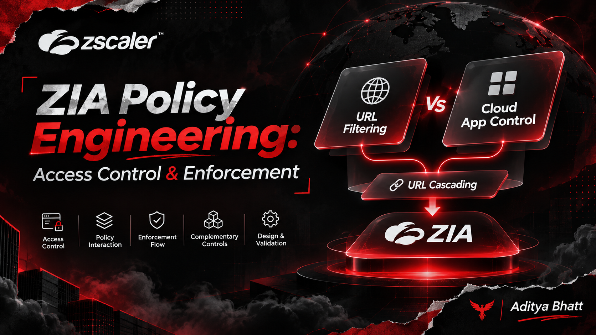

# ZIA Policy Engineering | Access Control & Enforcement

### URL Filtering | Cloud App Control | Policy Cascading | Complementary ZIA Controls

**Author:** Aditya Bhatt

 <br/>

---

## Overview

Web access control is not simply about deciding whether a user can visit a particular website. Modern cloud applications expose multiple functionalities, data-transfer mechanisms, and application-specific operations that require different levels of security enforcement.

Zscaler Internet Access (ZIA) provides multiple policy engines to address these requirements.

Two important policy components are:

- **URL Filtering:** Controls access to web destinations based on URL categories, destination criteria, and applicable user or location context.
- **Cloud App Control:** Provides application-aware controls over supported cloud applications and their associated activities.

Although both can influence whether a user successfully accesses a particular service, they operate with different policy objectives.

This repository explores their differences, interactions, policy precedence, cascading behaviour, and complementary ZIA security controls through independently developed conceptual scenarios.

## Core Concept

The fundamental distinction can be expressed as:

> URL Filtering determines where a user can navigate, whereas Cloud App Control determines how a recognised cloud application can be used.

For example, allowing access to a collaboration platform does not necessarily mean allowing every operation within that platform.

An organisation may permit users to access a service while restricting supported activities such as file uploads, downloads, publishing, or sharing.

This is where application-aware enforcement becomes relevant.

## Repository Objectives

- Understand URL Filtering and Cloud App Control independently.
- Identify the differences between destination-based and application-aware enforcement.
- Understand policy evaluation order and precedence.
- Examine URL Cascading and its impact on policy decisions.
- Explore the relationship between application permissions and destination restrictions.
- Understand complementary controls such as DNS Control, Firewall Control, DLP, and File Type Control.
- Examine realistic security requirements through conceptual case scenarios.
- Identify limitations, inspection dependencies, and policy-design considerations.

## Repository Structure

```text
ZIA Policy Engineering
│
├── README.md
├── LICENSE
├── Cover.png
├── 01-foundations-and-policy-selection.md
├── 02-policy-order-and-url-cascading.md
├── 03-original-case-scenarios.md
├── 04-complementary-controls.md
├── 05-design-considerations-and-validation.md
└── 06-glossary-and-reference-links.md
```

## Policy Comparison

| Requirement | Relevant Policy |
|---|---|
| Restrict access to website categories | URL Filtering |
| Allow a website but restrict supported application activities | Cloud App Control |
| Restrict access to a recognised cloud application | Cloud App Control |
| Apply destination restrictions after an application allow | URL Cascading |
| Restrict DNS resolution | DNS Control |
| Restrict network traffic by IP, port, or protocol | Firewall Control |
| Restrict specific file types | File Type Control |
| Prevent sensitive information from leaving | DLP |
| Inspect eligible encrypted traffic | SSL/TLS Inspection |
| Contain access to risky websites | Browser Isolation |

## Understanding Policy Interaction

Cloud App Control is evaluated before URL Filtering in the documented ZIA policy interaction.

Under default behaviour:

- An explicit Cloud App Control block remains blocked.
- An explicit Cloud App Control allow normally prevents URL Filtering from evaluating that transaction.
- When Cloud App Control has no matching rule, URL Filtering can evaluate the transaction.
- URL Cascading allows URL Filtering to evaluate a transaction following an explicit Cloud App Control allow.

This interaction is particularly important when both policies are intended to enforce different restrictions on the same application.

## Conceptual Scenarios

The repository explores independently developed scenarios involving:

1. Design collaboration platforms with restricted publishing activities.
2. Personal cloud storage with restricted file transfers.
3. Streaming platforms with destination-level restrictions.
4. Developer collaboration platforms with application and data-protection requirements.
5. Malicious domains requiring DNS-layer enforcement.
6. Sensitive information transfers requiring DLP.
7. Unknown cloud applications requiring risk-based access decisions.

These scenarios are illustrative security designs rather than completed deployment exercises.

## Complementary Security Controls

URL Filtering and Cloud App Control are not the only mechanisms available within the ZIA security architecture.

Additional controls can address different enforcement requirements:

- DNS Control
- Firewall Control
- File Type Control
- Data Loss Prevention
- SSL/TLS Inspection
- Advanced Threat Protection
- Sandbox
- Browser Isolation
- Cloud Application Risk Profiles

Their inclusion depends on the security requirement, traffic visibility, product availability, and configured enforcement path.

## Important Considerations

Policy behaviour depends on several factors:

- Application recognition and supported activities.
- Rule precedence and matching criteria.
- User and group identification.
- Location and traffic-forwarding configuration.
- SSL/TLS inspection and exclusions.
- URL Cascading configuration.
- Application-specific exceptions.
- Traffic visibility and supported protocols.

A policy being configured does not automatically establish that every possible traffic path is covered.

## Official Documentation

Refer to the official Zscaler documentation for current product behaviour, configuration options, and supported features.

- [Zscaler Help Center](https://help.zscaler.com/)
- [About URL Filtering](https://help.zscaler.com/legacy-zia/about-url-filtering)
- [About Cloud App Control](https://help.zscaler.com/zia/about-cloud-app-control)
- [Configuring Advanced Settings](https://help.zscaler.com/zia/configuring-advanced-settings)
- [ZIA Policy Leading Practices Guide](https://help.zscaler.com/zscaler-deployments-operations/zia-policy-leading-practices-guide)

---

**Author:** Aditya Bhatt

*An independent technical knowledge repository exploring ZIA policy behaviour, application-aware enforcement, and layered web security.*
